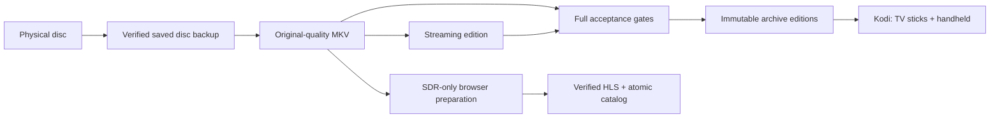

# Architecture and ownership

## Machines

A setup that worked well, using two hosts:

- **Media host** ("rig"): optical drive(s), CPU/GPU for encoding, the disks holding scratch, archive and the finished library. Runs the workers as systemd units. Serves media read-only on the LAN.
- **App host**: the agent runtime, scheduler/watchers, TLS front end for the browser player. Holds no media.
- **Clients**: Kodi on streaming sticks (TV), Kodi on a Steam Deck (desktop mode), and browsers/phones for the HLS movie page.

One box can do it all. Keep the logical split anyway: workers, storage, delivery and the agent's own notes have different failure and backup rules.

## Storage tiers

| Tier | Purpose | Rule |
|---|---|---|
| Primary scratch (fast SSD/NVMe) | originals in progress, encode intermediates | disposable, but budget the whole filesystem: it may be the OS disk |
| Secondary scratch | saved disc backups awaiting processing | often shares a disk with *other* backups; set a cinema cap, never treat the volume as yours |
| Archive (big HDD) | finished editions, private work/evidence dir | finished media is immutable; private work dir never exposed through media routes |
| Mobile/HLS export | browser renditions only | served read-only by a minimal origin |

Set **free-space floors** per tier (we used 80 GiB on scratch, 200 GiB on archive) and an aggregate cap on secondary scratch. A preflight must account for *peak* use, not current free space: the source and destination coexisting during a copy, a full remux next to its input, output growth of running jobs, other jobs' reservations, and filesystem overhead. See `examples/disk_guard.py`.

Capacity numbers are budgets for the next stage, not permanent permission.

## Delivery paths

- **Kodi clients (TV sticks, handheld):** read-only authenticated SMB shares for both editions, distinctly named. Network playback; no full local copies.
- **High-bitrate UHD on weak clients:** if a device stutters on high-bitrate titles over SMB, serving those files over read-only HTTP can help until the issue is fixed in Kodi. See [clients](05-clients.md#smb-vs-http-for-high-bitrate-uhd).
- **Browser:** separate SDR HLS library (720p H.264 + AAC stereo / AC-3 5.1). This is not the UHD path.

Kodi media path identity matters: resume points and watched state key on the path. Don't move or rename published files once a client has indexed them.

## Ownership boundaries

- The **web app repo** owns UI, player and canonical HLS prepare/validate tools. Pipeline docs reference it by commit; never fork it.
- The **pipeline project** (private) owns procedure, decisions, checkpoints and frozen per-title tool generations.
- An **active worker's deployed scripts** are authoritative for that run. Never edit them while it runs; build the next generation separately.
- **One continuation owner** (watcher) per job. Don't start a competing scheduler.
